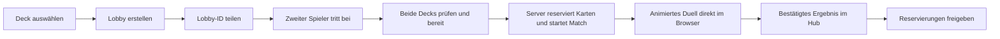
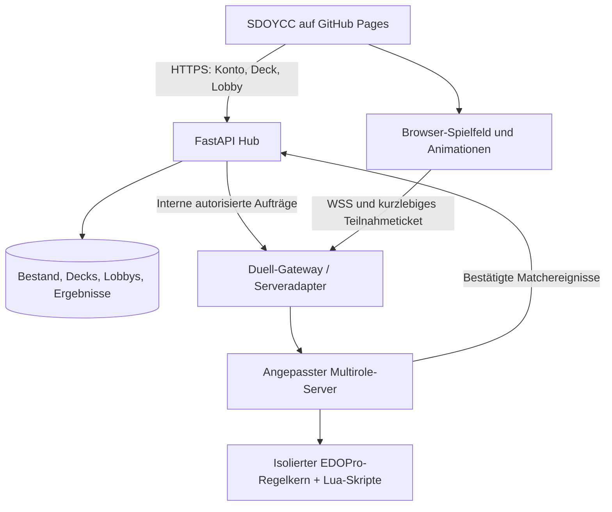

# Deck Builder und DuelZone – Konzept und Umsetzungsstand

Stand: **05.10.2026**, überarbeitet nach Betreiberentscheidung: **vollständig browserbasiert, vollständige Spielregeln und animierte Duelle**. **Implementierung vom Betreiber mit „dann starte nun wenn alles passt“ freigegeben und begonnen.** Alle nachfolgenden Produktlimits sind Vorschläge, soweit sie nicht ausdrücklich als TCG-Regeln bezeichnet sind. D0 läuft als isoliertes Techniklabor; Konten, Kartenbestände, laufende Produktionsdienste und die veröffentlichte Website wurden dafür nicht verändert.

**Erster Umsetzungsstand:** Ein echtes Engine-Duell mit zwei getrennten Browser-Sitzungen, verdeckten Handkarten, Zaubereffekt/Kettenauflösung und Sieg ist lokal bestanden. Das Labor verwendet feste Testdecks und deckt noch nicht alle Entscheidungen oder Animationen ab. Externe Netzprüfung, vollständige Regel-/Kartenabdeckung und Hub-Anbindung stehen aus; D0 ist noch nicht insgesamt abgeschlossen. Startanleitung, Prüfnachweise und Grenzen: [DuelZone-Techniklabor](../../integrations/duel/README.md).

**Fortschritt 05.10.2026:** Versionierte Regel-Kandidaten, privater Deck-Editor mit Besitz-/Kopienprüfung und YDK, mobile Bedienung, Entwurfswiederherstellung sowie private Zwei-Konto-Lobbys sind lokal umgesetzt. Zusätzlich ist die interne atomare Reservierung beider Decks einschließlich unveränderlichem Start-Snapshot getestet. Sie ist noch nicht an einen öffentlichen Startablauf angeschlossen. Die vollständige Engine-/Regionsfreigabe bleibt gesperrt. Genaue Bedienwege, Grenzen, Tests und nächste Schritte: [aktueller Entwicklungsstand](../DECKS_DUELZONE_STATUS.md). Dieser Ausbau wurde noch nicht veröffentlicht.

## 1. Ziel und festgelegter Aufbau

**Ergänzung zum lokalen Umsetzungsstand:** Die Lobby bietet inzwischen eine beidseitige, zeitlich begrenzte Deckbestätigung. Sie wird bei Deck-/Spielerwechsel ungültig und kann zurückgenommen werden. Die interne Reservierungsgrenze verlangt diese Zustimmung beider Konten; die öffentliche Freigabe des vollständigen Worker-Betriebs steht weiterhin aus.

**Weiterer Nachweis:** Der authentifizierte Hub-Worker ist inzwischen als standardmäßig abgeschalteter Entwicklungsmodus implementiert und mit zwei Browserkonten gegen den echten Core geprüft. Eine zusätzliche Zustimmung beider Spieler erlaubt dem Gastgeber den begrenzten Teststart; reservierte Snapshots, private Ansichten, Neuladen und Aufgabe/Ergebnisfreigabe funktionieren. Das ersetzt keine vollständige Freigabe: Kartenpool, HTTP-Testtransport, Betriebssystem-Isolation und Wiederherstellung nach Serverabsturz haben weiterhin die im Entwicklungsstand beschriebenen Grenzen.

Spieler bauen aus ihrer Sammlung regelkonforme Decks, eröffnen eine private Lobby, teilen deren ID und spielen gegeneinander. Beide Konten müssen im Hub angemeldet sein. Karten bleiben nach dem Duell erhalten. Der Sieger erhält keine Karten des Gegners.

**Festgelegt:** Deck Builder, Lobby, Spielfeld, Side-Deck-Wechsel, Replays und Ergebnisübersicht laufen direkt in SDOYCC im Browser. Spieler benötigen weder EDOPro noch einen Launcher, Verbindungshelfer, eine Browsererweiterung oder einen Download. Eine optionale YDK-Datei ist ausschließlich Import-/Exportkomfort und keine Spielvoraussetzung.

**EDOPro bleibt die technische Regelbasis:** Regelkern, Lua-Kartenskripte und passende Kartendaten laufen serverseitig. Der Browser erhält nur die für seinen Spieler zulässige Ansicht und die aktuell erlaubten Entscheidungen. Die Engine entscheidet verbindlich über Spielverlauf und Ergebnis. Eine vollständige Browseroberfläche einschließlich Animationen gehört zum Erstumfang.

| Bestandteil | Verbindliche Richtung |
| --- | --- |
| Regeln und Karteneffekte | EDOPro-Regelkern und geprüfte Skripte, ohne vereinfachte Ersatzregeln |
| Oberfläche | Eigener deutscher SDOYCC-Browserclient mit vollständiger Spielbedienung |
| Darstellung | Animierte Kartenbewegungen, Beschwörungen, Ketten, Kämpfe und Ergebnisse; Details in Abschnitt 7 |
| Teilnahme | Hub-Anmeldung und Lobby-ID, anschließend direkt im Browser spielen |
| Geräte | Desktop und Touchbedienung; konkrete Browser-/Gerätematrix in D0 festlegen und vor Freigabe testen |
| Server | Eigener Duellprozess mit sicherem WebSocket-Gateway, vom Hub-Inventar getrennte Spielzustände |

EDOPro ist ein nativer Client; das Hauptrepository verweist auf einen gesonderten Regelkern, Kartenskripte und Kartendaten. Eine fertige Einbettung in unsere React-Seite ergibt sich daraus nicht. Das alte Repository `ProjectIgnis/EDOPro` ist archiviert und verweist auf `edo9300/edopro`. [Client](https://github.com/edo9300/edopro), [archivierter Verweis](https://github.com/ProjectIgnis/EDOPro), [Regelkern](https://github.com/edo9300/ygopro-core)

## 2. Anschluss an das vorhandene System

Im aktuellen Projekt vorhanden: React/Vite mit Hash-Routen, FastAPI, SQLAlchemy/SQLite, Twitch-bestätigte Hub-Konten, Kartenkatalog, Variantenbestand, Handel mit Reservierungen, Admin-Rechte und Journale. Ein isolierter D0-Duellserver ist implementiert. Im lokalen Entwicklungsstand sind Deck Builder und Lobby-Vorbereitung in den Hub eingebunden; die Verbindung zum vollständigen Duellworker und die Veröffentlichung stehen aus.

Wir bauen auf `Card`, `CardDetails`, `CardVariant`, `VariantInventory` und den Bestands-/Kontosperren auf. `InventoryItem` bleibt die vorhandene Gesamtsumme. Kein zweites unabhängiges Karteninventar für Duelle.

Wichtige Lücken im heutigen Modell:

- `CardDetails.ban_status` ist keine versionierte, regionsbezogene Turnier-Bannliste.
- Katalog-ID, Anbieter-ID, alternative Illustration, EDOPro-Passcode und regeltechnische Kartenidentität sind nicht automatisch gleich.
- Hub-Seltenheit und Herkunft sind keine verlässlich bestimmte physische Druckausgabe; die Duellregeln dürfen daran keine zusätzliche Kopie ableiten.
- `InventoryReservation` ist auf Handel zugeschnitten und enthält derzeit keinen Bindungsstatus. Duellreservierungen müssen gebundene und ungebundene Varianten korrekt unterscheiden; die Tabelle nicht ungeprüft für Duelle wiederverwenden.
- Die lokale SQLite-Datenbank genügt als zu prüfender kleiner Startpunkt. Duellaktionen werden nicht pro Spielzug in Inventartabellen geschrieben. Mehrere API-Worker benötigen datenbankgestützte Sperren; ein reiner Prozesslock reicht dafür nicht.

## 3. Deck Builder: Bedienung und Gestaltung

Neue Sidebar-Einträge **Meine Decks** und **DuelZone**. Der Begriff „Deck Builder“ kann als Funktionsname in der Dokumentation bleiben; Bedienung, Fehlermeldungen und Hilfen sind deutsch. Kartentexte/Bilder folgen dem bestehenden Deutsch-/Original-Fallback.

### Meine Decks

- Deckübersicht mit Name, Titelkarte, Haupt-/Extra-/Side-Deck-Zähler, letztem Änderungsdatum und gewähltem Format.
- Separate Statusanzeigen: **Regelkonform**, **Karten verfügbar**, **Engine-kompatibel**. Erst alle drei ergeben **Duellbereit**.
- Erstellen, umbenennen, duplizieren, archivieren und löschen mit Bestätigung; eigenes Deck standardmäßig privat.
- Vorschlag: 30 aktive Decks pro Konto; Entwürfe dürfen unvollständig sein. Kein Kaufpreis für Deckplätze in der ersten Version.
- Deckliste teilen zunächst nur durch bewusst erzeugten Link; standardmäßig wird nichts veröffentlicht. Geteilte Vorlagen gewähren keine Karten.

### Editor

- Desktop: links durchsuchbare Sammlung, mittig Haupt-/Extra-/Side-Deck, rechts Kartenbild, Text und Prüfhinweise.
- Mobil: Reiter statt drei schmaler Spalten; Hinzufügen/Entfernen per Schaltfläche. Drag-and-drop ist optional, nie die einzige Bedienung.
- Standardfilter „Meine verfügbaren Karten“; umschaltbar auf „gesamter Katalog“, um Wunschdecks zu planen.
- Filter: Name/Text, Kartentyp und Unterart, Attribut, Stufe/Rang, Linkwert, ATK/DEF, Pendelskala, Archetyp, Formatfreigabe, Bannstatus, Besitz/Verfügbarkeit, Seltenheit und Herkunftsset.
- Jede Karte zeigt „im Deck / im Besitz / momentan verfügbar“ und ihr gemeinsames Kopienlimit. Fehlende Exemplare bleiben als klar markierte Platzhalter im Entwurf.
- Die Zuordnung zum Haupt- oder Extra-Deck erfolgt anhand geprüfter Engine-Typdaten; Side-Deck bewusst auswählbar.
- Klick auf Karte öffnet dieselbe Art lesbarer Detailvorschau wie beim Pack-Opening; Seltenheit ist kosmetisch und verändert keine Spielwerte.
- Fehler benennen Ursache und Ort: etwa „39 Hauptdeckkarten, mindestens 40 erforderlich“, „Karte X: insgesamt 4, erlaubt 3“, „2 benötigt, nur 1 frei“, „nicht im TCG freigegeben“.
- Autospeicherung mit sichtbarem Status und Versionsprüfung. Bei Bearbeitung in zwei Tabs keine stillen Überschreibungen.
- Wunschkarte verlinkt auf passende Booster und Handelsangebote; weder Kauf noch Öffnung garantieren den Fund.

### Import, Export und Testhand

- `.ydk` importieren/exportieren; Passcodes über die geprüfte Zuordnung auflösen. Import erzeugt einen Deckentwurf und niemals Besitz.
- Fremde/unbekannte Nummern einzeln melden; keine stillen Ersetzungen. Höchstens 100 KB und 200 Karteneinträge pro Import als Schutzlimit; reguläre Decklimits gelten zusätzlich.
- YDK transportiert keine Hub-Kontoberechtigung und keine verlässlich gebundene Seltenheitsauswahl.
- Deckstatistik: Monster/Zauber/Fallen, Stufen-/Typverteilung, fehlende Karten. Keine unbelegte Aussage wie „garantiert kompetitiv“.
- Optionale Testhand nutzt nur den Entwurf und vergibt weder Karten noch XP. Sie ist keine vollständige Effektsimulation im Browser.

## 4. Spielregeln und zugelassene Formate

### Standard: SDOYCC Sammlung – TCG Advanced

| Eigenschaft | Festlegung |
| --- | --- |
| Teilnehmer | Zwei Spieler, ein Konto pro Seite |
| Hauptdeck | 40–60 Karten |
| Extra-Deck | 0–15 Karten |
| Side-Deck | 0–15 Karten |
| Kopien | Normalerweise höchstens 3 derselben regeltechnischen Karte über alle drei Bereiche zusammen |
| Verboten / limitiert / halblimitiert | 0 / 1 / 2 insgesamt; in keinem Deckbereich umgehen |
| Lebenspunkte | 8.000 pro Spieler |
| Starthand | 5 Karten; beginnender Spieler zieht in seinem ersten Zug nicht |
| Spielweise | Einzelduell als Standard, optional Match bis zwei Duellsiege |
| Verbrauch | Keine Karten verbrauchen, kein Karteneinsatz |

Grundlage: [offizielles Regelbuch](https://img.yugioh-card.com/en/downloads/rulebook/SD_RuleBook_EN_10.pdf) und [Konamis Regeln zur Deckkonstruktion](https://www.yugioh-card.com/en/limited/). Diese Grundregeln allein ersetzen nicht aktuelle Regelergänzungen und kartenspezifische Ausnahmen.

Es gilt das aktuelle, ausdrücklich als TCG freigegebene Engine-Regelprofil. Fusion/Synchro/Xyz benötigen bei Erstbeschwörung aus dem Extra-Deck nicht grundsätzlich eine verlinkte Zone; für Link- und offene Pendelmonster aus dem Extra-Deck bleiben die entsprechenden Einschränkungen relevant. Nicht lediglich ein ungenau benannter „Master Rule 5“-Schalter übernehmen. [Konami-Regelergänzungen](https://www.yugioh-card.com/en/play/2021_rules_update/)

Der Regelkern übernimmt Phasen, Zugreihenfolge, Beschwörungen, Ketten und Reaktionsfenster, Kosten/Ziele, Kampfschritte, Effekte, Zähler, Tokens, Zufall, LP und alternative Siegbedingungen. Browser oder Hub erfinden dafür keine zweite Regelimplementierung. TCG-/OCG-Unterschiede bei Timing und Effekten müssen im gewählten Profil mit konkreten Fällen getestet werden; vollständige Fehlerfreiheit aller Skripte wird nicht behauptet.

**Betreiberanforderung „alle Regeln beibehalten“:** Das gewählte vollständige TCG-Regelwerk wird nicht für eine einfachere Browserbedienung gekürzt. Alle Phasen, Beschwörungsarten, Kettenfenster, Pflichtentscheidungen, Kartenbedingungen und zulässigen Ausnahmen müssen über die Engine ausführbar sein. Kein automatisches Überspringen einer Reaktion, weil ein Auswahlfenster noch fehlt. Historische Formate, OCG, Rush Duel und weitere eigenständige Regelwerke bleiben separate Profile; „vollständig“ bedeutet nicht deren widersprüchliche Regeln gleichzeitig zu vermischen. Ein isolierter Prototyp darf einen kleinen Testpool verwenden, die fertige Version darf dadurch nicht still auf vereinfachte Duelle beschränkt werden.

### Kartenfreigabe und Grenzen

- Format zum Start: **TCG Advanced für unsere europäische Community**, mit versionierter TCG-Veröffentlichungsfreigabe. Nicht jede im weltweiten Katalog vorhandene Karte ist deshalb spielbar.
- OCG-exklusive, noch nicht veröffentlichte, Anime-, Rush-Duel-, Skill- und nicht freigegebene Community-Karten bleiben im Sammelkatalog, werden aber für dieses Format abgewiesen. Einzelne Produkte können mit TCG kompatible Karten enthalten; Produktname allein ist keine Ausschlussregel.
- Tokens gehören nicht als reguläre Einträge ins Haupt-/Extra-/Side-Deck. Während des Duells erzeugte Spielmarken benötigen keinen gekauften Token im Inventar.
- Ritualmonster gehören ins Hauptdeck; Fusions-/Synchro-/Xyz-/Linkmonster ins Extra-Deck. Pendel-Hybridtypen werden anhand der Engine-Daten einsortiert, nicht durch einfache Namenssuche.
- Andere Illustration, Sprache oder Seltenheit erhöht das Kopienlimit nicht. Dauerhafte Namensgleichheit/Aliasregeln werden durch die geprüfte Regelidentität berücksichtigt. Temporäre Namensänderungen auf dem Feld dürfen die Deckbauzählung nicht verfälschen.
- Sammlungssonderkarten erhalten nicht automatisch einen Effekt durch ihren Beschreibungstext. Eigene spielbare Karten würden geprüfte Daten, eigene sichere Lua-Skripte und ein separates Community-Format benötigen.
- Ein gekauftes Structure Deck ist eine Vorlage; es ist nicht automatisch unter jeder späteren Bannliste legal. Erzeugte Tokens und Bonuskarten werden nicht blind in ein 40-Karten-Hauptdeck gezählt.

### Bannlisten und Datenversionen

Die EU-Konami-Seite ist die Referenz für die regional relevante Freigabe. Bei der Recherche verlinkte die US-Übersicht eine Liste mit Gültigkeit ab **21.09.2026**; dies ist eine Momentaufnahme und keine für den späteren Start fest codierte Zusage. Vor Aktivierung europäische Gültigkeit und tatsächlich neueste Liste erneut prüfen. [EU-Liste](https://www.yugioh-card.com/eu/play/forbidden-and-limited-list/), [recherchierte US-Liste](https://www.yugioh-card.com/en/limited/list_2026-09-21/)

Eigene `RuleProfile`-/`BanlistVersion`-Datensätze speichern Region, Wirksamkeitsdatum, Quelladresse, Prüfsumme, erlaubte Kartencodes und Limits. Vorbereitete EDOPro-Listen dienen als technische Importquelle; Änderungen werden verglichen, getestet und durch einen Admin aktiviert. Ein einzelnes altes `ban_status` aus dem Katalog ist nicht maßgeblich.

Ein Match bindet sich an ein unveränderliches Gesamtpaket aus Client-/Protokollversion, Engine, Kartendaten, Skripten, Bannliste und Regelprofil. Keine automatischen Updates mitten im Match. Neue Listen kennzeichnen betroffene gespeicherte Decks als erneut zu prüfen; laufende Matches behalten ihre Version. Vorbereitetes Match nach dem offiziellen Wechsel nur mit explizit angezeigter alter Formatversion fortführen, nicht still als aktuelles Advanced ausgeben.

### Side-Deck und Match

Beim Start wird die vollständige Kartenmenge in allen drei Bereichen festgeschrieben. Zwischen Duellen sind nur Austausche aus dieser Menge erlaubt. Haupt-/Extra-/Side-Deck behalten ihre jeweilige Anfangsgröße; Typzuordnung und Limits gelten weiter. Kein Zukauf, Import oder Tausch neuer Karten in ein laufendes Match. Der geprüfte Multirole-Code vergleicht bereits Anfangsgrößen und die gesamte Karten-Multimenge; die Hub-Anbindung ergänzt Besitz- und Snapshotbindung. [Side-Deck-Code](https://github.com/DyXel/Multirole/blob/master/src/Multirole/Room/State/Sidedecking.cpp)

Ein Unentschieden zählt nicht als Sieg. Für den Matchmodus sind Gleichstände, weitere Duelle bis zum zweiten Sieg und ein erreichter Sicherheitszeitraum ausdrücklich im Engine-Prototyp zu verifizieren. Keine ungetestete Behauptung „genau drei Spiele“. Zwischen neuen Matches Ausgangsdeck wiederherstellen und erneut prüfen.

## 5. Kartenbesitz und Schutz vor Handel während des Duells

**Gespeicherte Decks sind Listen, keine dauerhaften Reservierungen.** Dieselbe besessene Karte darf in mehreren gespeicherten Decks stehen. Es ist nur eine aktive DuelZone-Teilnahme pro Konto erlaubt.

Für den Duellstart gilt je konkreter Kartenidentität: benötigte Menge über alle drei Deckbereiche ≤ tatsächlich verfügbare zulässige Exemplare. Varianten werden zusammengezählt, die ausgewählten Exemplare aber auf konkrete `VariantInventory`-Zeilen zurückgeführt. Gebundene Karten dürfen gespielt werden; Bindung untersagt weiterhin deren Handel. Altbestand mit unbekannter Rarity ist spielbar, wenn Identität und Regelzuordnung sicher sind.

Bei **Bereit**:

1. Anmeldung, Kontosperren, Duellsperren, Deckversion und Regelpaket prüfen.
2. Alle Deckkarten serverseitig validieren. Bereits für Handel oder ein anderes Match reservierte Exemplare sind nicht verfügbar.
3. Benötigte gebundene/ungebundene Varianten atomar reservieren und einen unveränderlichen Deck-Snapshot erstellen.
4. Lobbyversion und Sitzplatz verbindlich bestätigen. Gleichzeitiger Handel und Bereitklick dürfen nicht beide dieselbe letzte Karte erhalten.

Bei Deck-/Regeländerung geht Bereit verloren; betroffene Reservierungen werden freigegeben und beide Spieler sehen die Änderung. Während des gestarteten Matches bleibt die Reservierung bis zum bestätigten Ende bestehen. Das Editieren eines gespeicherten Decks verändert das laufende Match nicht.

Reservierung verändert nicht die Besitzmenge und erzeugt keine Kartenbewegung. Sie wird für Handel, Korrekturen und Adminabzüge berücksichtigt. Vorschlag: neue gemeinsame Reservierungsdienste mit Zweck, Konto, Variante, Bindungsstatus, Menge und Referenz; bestehende Handelsreservierungen erhalten bei der Migration den passenden bisherigen Bindungsstatus. Konsistenzprüfung: reservierte Summen entsprechen aktiven Reservierungen.

Nicht gestartete Bereit-Reservierung verfällt nach zwei Minuten ohne erfolgreichen Start. Bei laufendem Match genügt ein abgelaufener Zeitstempel **nicht** zur Freigabe: erst Workerstatus klären oder das Match verbindlich abbrechen. Sonst könnte ein laufender Spieler seine Karten weiterhandeln. Freigabe ist wiederholbar und genau einmal wirksam.

## 6. Lobby-ID und Ablauf

Beispiel: **`SDO-7K4P-9M2R`**. Zufälliger Code aus acht gut unterscheidbaren Zeichen, Kollisionsprüfung, begrenzte Eingabeversuche. Intern besitzt jede Lobby eine separate UUID. Der Code findet eine Lobby; er authentifiziert weder ein Konto noch einen Duellclient.

Lobbyansicht: zwei Spielerplätze mit Twitch-Namen, Verbindung, Deckbereit-Status, Format/Bannlistendatum, Einzelduell/Match, Zeitprofil und klarer Startschaltfläche. Dem Gegner weder Deckname mit möglichen Strategiehinweisen noch Deckinhalt ohne bewusste Freigabe zeigen. Die eigene Deckliste bleibt sichtbar.

Vorgeschlagener Standard: private Lobby per Code, Host bestätigt den beitretenden Spieler. Optional kann der Host vorab ein bestimmtes Hub-Konto einladen; dann darf nur dieses den zweiten Platz annehmen. Lobbybeitritt gibt keinen Zugriff auf fremde Sammlung oder versteckte Spieldaten.

Lebenszyklus: `offen → vollständig → bereit → startet → im Duell → Side-Deck/weiteres Duell → beendet`; zusätzlich `abgebrochen`, `abgelaufen`, `technisch ungeklärt`.

| Produktlimit | Vorschlag zum Start |
| --- | --- |
| Aktive Teilnahme | 1 Lobby/Match je Konto; zweiter Browser-Tab erzeugt keinen zweiten Sitz |
| Plätze | 2 Spieler; Zuschauer zunächst deaktiviert |
| Unbesetzte Lobby | Nach 15 Minuten Inaktivität schließen |
| Bereit-/Verbindungsaufbau | 120 Sekunden, danach zurücksetzen und Reservierungen lösen |
| Lobbyerstellung | Höchstens 5 je 10 Minuten/Konto |
| Falsche Beitrittscodes | 10 je 5 Minuten/Konto, ergänzende faire IP-Begrenzung |
| Parallelität erster Test | Maximal 5 Matches, nach Messung erhöhen |
| Duellzeit | Vorgeschlagenes Engine-Zeitprofil 180 Sekunden; Zählweise/Auffüllung in D0 prüfen und korrekt anzeigen |
| Side-Deck-Zeit | Vorschlag 180 Sekunden; Server setzt Ablauf und Konsequenz durch |

Diese Zeitlimits sind **Hub-Regeln**, keine Übernahme offizieller Turnier-End-of-Match-Verfahren. Zeitüberschreitung, Aufgabe und Nichtbereitwerden erhalten unterschiedliche Ergebnisgründe. Eine administrative maximale Matchdauer dient dem Betrieb und führt bei ungeklärtem Zustand zu Abbruch ohne Wertung, nicht zu einem frei erfundenen Sieger.

Nur der Host darf vor Start Einstellungen ändern, Teilnehmer entfernen oder die Lobby schließen. Nach Start bestimmt der Server den Lebenszyklus; Hostrechte erlauben keine Gegnerniederlage per Kick. Ein Rematch ist ein neues Match mit erneuter Prüfung und unveränderten Besitzmengen.

## 7. EDOPro-Anbindung und Serverarchitektur

**Kandidat: Multirole**, ein eigener EDOPro-kompatibler Server. Er arbeitet mit dem EDOPro-Kern und bietet unter anderem Prozessisolierung und serverseitige Replays. Das frühere ProjectIgnis-Repository leitet auf `DyXel/Multirole` um. Eignung und Wartungsstand werden vor Festlegung praktisch geprüft. [Projektbeschreibung](https://github.com/DyXel/Multirole)

### Was neu entwickelt werden muss

- Autorisierter Raumstart aus dem Hub; Lobby-ID auf interne Raum-ID abbilden.
- Konto an Sitzplatz binden: kurzlebiges, einmaliges Ticket für Konto, Lobby, Sitzplatz, Snapshot und Regelpaket. Vorschlag 60 Sekunden Gültigkeit, atomare Einlösung; der Browser authentifiziert sich gegenüber dem Gateway, interne Engine-Verbindungen benötigen keine Hub-Passwörter oder Streamer.bot-Schlüssel.
- Deck **vor Start** aus dem geprüften serverseitigen Snapshot laden. Manipulierte Deckdaten aus Browseranfragen dürfen ihn nicht ersetzen. Bei Side-Deck-Wechseln zusätzlich gleiche Gesamtmenge und korrekte Bereichsgrößen prüfen.
- Eigene Raumkonfiguration durchsetzen: Clients dürfen weder „Deck nicht prüfen“ noch zusätzliche Teilnehmer, andere LP oder abweichende Listen aktivieren.
- Matchereignisse serverseitig signieren/authentifizieren, mit Match-ID, Worker-Generation, fortlaufender Ereignis-ID und wiederholbarer Verarbeitung an FastAPI zustellen.
- Versteckte Karten ausschließlich an berechtigte Empfänger geben. Ein gemeinsames volles Spielfeldobjekt an beide Clients wäre falsch, auch wenn die Oberfläche Kartenrückseiten zeichnet.
- Ältere oder inkompatible Browser-Builds mit verständlicher Meldung vor Matchstart ablehnen; laufende Matches nicht durch ein Website-Update zwangsweise neu laden.

**Diese Hub-Hooks sind keine dokumentierte fertige Multirole-Komplettintegration.** In D0 werden die realen Eintrittsstellen geprüft; voraussichtlich benötigt der Server einen kleinen gepflegten Fork oder einen protokollkundigen Adapter. Ein bloßer TCP-Weiterleiter kann Besitz, Side-Deck-Regeln und Identität nicht allein gewährleisten.

Das aktuelle EDOPro-Protokoll enthält Spielername, Raumkennung, Passwort und Versionsinformationen. Ein frei eingegebener Nickname ist kein Hub-Login; gemeinsames Raumkennwort ist kein individueller Kontoausweis. Eigene Tickets dürfen nicht ungeprüft in begrenzte Protokollfelder gesteckt werden. [Protokolldefinition](https://github.com/edo9300/edopro/blob/master/gframe/network.h)

### Vollständiger Browserclient

Der Server bleibt die Regelinstanz. Zusätzlich erforderlich: Darstellung aller Zonen, eigener Handkarten und verdeckter Gegnerkarten; Auswahl von Materialien/Zielen/Mengen/Positionen; Effekt- und Kettenentscheidungen; Optionsdialoge; Kampf-/Phasensteuerung; Side-Deck; Aufgeben; Reconnect und barrierearme Bedienung. Animationen dürfen Entscheidungen nicht blockieren. Clientantworten müssen exakt zum ausstehenden Engine-Prompt passen.

Es genügt nicht, Karten per Drag-and-drop auf eine Spielmatte zu legen. Alle von den freigegebenen Kartenskripten verwendeten Entscheidungstypen brauchen eine Bedienung. Bei unbekanntem Prompt kontrolliert stoppen und Diagnose sichern, nicht willkürlich einen Spielzug auswählen. Auf Smartphones erst nach Tests der vollständigen Bedienung freigeben.

Der Protokolladapter übersetzt Engine-Nachrichten in versionierte Browser-Ereignisse und Entscheidungen. Er ist kein zweiter Regelkern. Jede Antwort trägt Match-, Sitzplatz- und Promptkennung; veraltete oder doppelte Antworten werden verworfen. Erforderlich ist ein vollständiges Verzeichnis der Entscheidungstypen im festgelegten Enginepaket, einschließlich Auswahl/Abwahl, exakter oder variabler Mengen, Materialsummen, Reihenfolgen, Kartennamen/Zahlen/Attributen, Zonen, Positionen sowie verpflichtender und freiwilliger Reaktionen. Auch seltene Auswahlfenster gehören zur Abnahme.

Spielzustand, ausstehende Entscheidung und Animationsablauf sind getrennte Schichten. Der Server liefert autorisierte Zustände; die Oberfläche bietet zulässige Aktionen; die Darstellung macht deren Folgen sichtbar. Zufall, Kartenreihenfolge und LP werden niemals durch eine Browseranimation festgelegt. Ein öffentliches Ereignis enthält keine zusätzlichen privaten Daten nur für einen Effekt oder eine Vorschau.

### Animationen als fester Bestandteil

**Betreiberanforderung:** Duelle behalten die vollständigen Spielabläufe und deren visuelle Rückmeldung. Wir bilden EDOPros relevante Animationsabläufe im Browser nach und gestalten sie passend zu SDOYCC. Die native Rendertechnik lässt sich nicht unverändert einsetzen; eine pixelidentische Übernahme aller Effekte und Ressourcen ist damit nicht zugesagt. Vor Umsetzung entsteht in D0 eine Referenzliste aus dem ausgewählten EDOPro-Client mit Ereignis, Reihenfolge, Sichtbarkeit, Klang und vorgesehenem Browser-Pendant. So fallen bestehende Abläufe nicht unbemerkt weg.

| Ereignis | Geplante Darstellung |
| --- | --- |
| Duellbeginn | Spielerpräsentation, Spielmatte, Decks, LP und animierte Starthand; erste Auswahl bleibt klar sichtbar |
| Ziehen und Mischen | Kartenbewegung vom Deck zur Hand; Gegner sieht nur Rückseite/Mengen. Kein sichtbarer Zufallsverlauf, der Reihenfolge verrät |
| Setzen, Aufdecken, Position ändern | Bewegung und Drehung in die korrekte Zone, verständliche Angriffs-/Verteidigungsposition |
| Normal-/Tribut-/Ritual-/Spezialbeschwörung | Materialien/Tribute und Zielzone sichtbar, passende Beschwörungssequenz ohne vorzeitige Kartenenthüllung |
| Fusion, Synchro, Xyz, Pendel und Link | Eigene visuelle Abläufe; Materialbewegung, Überlagerung, Pendelbewegung und Link-Zonen nachvollziehbar |
| Aktivierung und Ketten | Sichtbare Aktivierung, nummerierte Kettenglieder, Auflösung in tatsächlicher Reihenfolge, klare Negierungsanzeige |
| Angriff und Schaden | Angriffsrichtung, Treffer, Zerstörung und animierte LP-Änderung; maßgeblich bleiben Serverwerte |
| Friedhof, Verbannen, Rückkehr, Ausrüsten, Kontrolle wechseln | Bewegungen zwischen den tatsächlichen Zonen; verdeckte Informationen bleiben verdeckt |
| Token, Zähler, Material entfernen, Werte ändern | Entstehen/Entfernen, Mengenschritte und nachvollziehbare neue Werte |
| Münze, Würfel, Auswahlen | Animation zeigt das vom Server ermittelte Resultat; keine zweite Zufallsziehung |
| Phasenwechsel und Ende | Aktive Phase/Spieler, Sieg/Niederlage/Unentschieden bzw. technischer Abbruch klar unterscheidbar |

Eine einzige generische Kartenbewegung erfüllt dieses Animationsziel nicht. Spezialsequenzen werden erst nach Regel- und Bedienabdeckung verfeinert; der veröffentlichte Funktionsumfang enthält die vollständige Ereignisfamilien-Abdeckung. Individuelle 3D-Filme für jede einzelne Karte werden nicht aus EDOPro vorausgesetzt und müssten als gesonderte Gestaltung definiert werden.

### Synchronisierung, Bedienbarkeit und Leistung

- Ereignisse erhalten fortlaufende Nummern. Kurze Animationen laufen geordnet; lange Rückstände werden auf den aktuellen autorisierten Zustand aufgeholt. Dieselbe Nachricht darf keinen zweiten Effekt und keine zweite Spielaktion auslösen.
- Eine noch laufende Animation verbirgt kein verpflichtendes Entscheidungsfenster. Bei neuem Prompt erforderliche Darstellung vorziehen oder verkürzen. Kein Spieler darf durch ausgeschmückte Effekte Bedenkzeit verlieren oder durch gefälschte Animationsbestätigungen Zeit gewinnen; Uhren bleiben servergesteuert, feste Präsentationsfristen müssen dort begrenzt sein.
- Einstellungen **Voll / Schnell / Reduzierte Bewegung**, Ton separat steuerbar. Alle Modi zeigen dieselben regelrelevanten Ereignisse und Auswahlmöglichkeiten. Kein automatisches Bestätigen eines Effekts beim Überspringen einer Animation.
- Hintergrund-Tab, Fensterwechsel und Browser-Drosselung dürfen keine Entscheidungen erfinden. Bei Rückkehr serverseitige Uhr und Zustand abgleichen; vergangene Effekte nicht minutenlang nachspielen. Regelrelevante Informationen bleiben im Duellprotokoll lesbar.
- Bei Verbindungsverlust lokale Eingaben sperren; nach Wiederverbindung autorisierte Zustandsansicht und aktuellen Prompt wiederherstellen. Bereits gesendete Antworten anhand ihrer Kennung abgleichen. Karten dürfen weder erneut gezogen noch Effekte erneut angewendet werden.
- Kartenbilder vorladen, soweit bekannt und für den Spieler sichtbar; keine Vorlade-Anfragen für geheime Gegnerkarten. Effekt-/Partikelbudget, Texturgrößen und parallele Animationen begrenzen. Der Duellkern bleibt auch bei reduzierter Grafik derselbe.
- Zielwerte für die Geräteabnahme: flüssige 60 Bilder/s am Referenz-Desktop, mindestens 30 Bilder/s auf dem festgelegten mobilen Testgerät in geeigneter Qualitätsstufe; keine Leistungsgarantie für unbekannte Geräte. Laufzeit und Speicher über längere Matches messen.
- Rendertechnik wird im Browser-Prototyp gewählt: HTML für lesbare Bedienung und barrierearme Dialoge, Canvas/WebGL nach Bedarf für die Spielmatte/Effekte. Diese Wahl ist kein Anlass, Engine-Regeln abzukürzen.

## 8. Betrieb ohne eigene Domain

GitHub Pages stellt weiterhin die Oberfläche bereit; dort können keine dauerhaften Duellprozesse laufen. FastAPI und ein separater Duellprozess laufen zunächst lokal, später bei Bedarf auf einem Server. Nur freigegebene Gateway-Endpunkte sind öffentlich erreichbar; Worker-/Adminports bleiben intern.

Der Browser verbindet sich per **HTTPS/WSS** mit dem Hub und dem Duell-Gateway. Eventuelle native EDOPro-Protokollverbindungen liegen ausschließlich intern zwischen Gateway und Duellserver. Spieler benötigen keine TCP-Weiterleitung und keine Zusatzsoftware. Der bisherige HTTPS-Tunnel allein stellt noch keinen fertigen Duell-Endpunkt bereit. [Cloudflare-Protokolle](https://developers.cloudflare.com/cloudflare-one/networks/connectors/cloudflare-tunnel/routing-to-tunnel/protocols/)

Ob der derzeitige Quick Tunnel für lange WebSocket-Verbindungen unter realer Last zuverlässig genug arbeitet, muss D0 nachweisen. Der Ansatz kann für einen Test ohne eigene Domain funktionieren; wechselnde URLs, Schlafmodus und Neustarts bleiben betriebliche Grenzen. Ein HTTPS/WSS-fähiger dauerhafter Hosting-Endpunkt wäre bei Bedarf die Alternative, nicht ein installierter Spielerclient. Keine Domain oder kostenpflichtige Infrastruktur wird ohne eigene Entscheidung bestellt.

Vor offenem Betrieb: Dauerbetrieb/Updates/Firewall/Backups, automatische Wiederherstellung, externe Verbindungstests, CPU/RAM-/Bandbreitenmessung. Vorgeschlagene Startkapazität von fünf Matches ist ein Testlimit, keine zugesagte Leistung. Regelkern und Skripte bleiben vom API-Prozess isoliert und laufen mit begrenzten Ressourcen.

## 9. Abbruch, Wiederverbindung und Ergebnisse

Die geprüften Multirole-Zustände behandeln einen verlorenen Spieleranschluss als Niederlage beziehungsweise Matchabbruch. **Nahtloses Reconnect ist daher ein eigener Entwicklungs- und Abnahmepunkt.** Ein wieder geöffneter Browser-Tab oder eine fortlaufende Lobbyanzeige beweist keine wiederhergestellte Partie. [Duellzustand](https://github.com/DyXel/Multirole/blob/master/src/Multirole/Room/State/Dueling.cpp)

Für die erste geschlossene Client-Erprobung: Abbruchregel offen anzeigen; kein Ranglistenverlust, weil es noch keine Rangliste gibt. Für die öffentliche Version empfohlen: 60 Sekunden Wiederverbindungsfrist, höchstens zwei Unterbrechungen und insgesamt 120 Sekunden je Match. Dazu müssen logischer Sitzplatz, ausstehender Prompt, Uhr und ausschließlich erlaubte Zustandsdaten wiederherstellbar sein. Keine Zurücksetzung der Bedenkzeit bei Reconnect. Diese Werte sind Vorschläge und gelten erst nach bestandenem Prototyp.

| Ereignis | Vorgesehene Behandlung |
| --- | --- |
| Browser wird geschlossen oder Seite neu geladen | Verbindung gilt als unterbrochen; logischer Sitzplatz bleibt innerhalb der geprüften Reconnect-Frist reserviert. Bei Rückkehr autorisierten Zustand und aktuellen Prompt wiederherstellen |
| Spieler gibt bewusst auf | Server bestätigt Aufgabe und Gewinner; Matchregel bestimmt Fortsetzung/Ende |
| Teilnehmerverbindung fällt aus | Im Pilot dokumentierte Engine-Regel; später geprüfte Reconnect-Frist mit eindeutiger Uhrbehandlung |
| Duellworker oder Regelkern stürzt ab | Technischer Abbruch ohne Wertung; kein erfundener Sieger |
| Nur Hub-API kurz weg, Worker lebt | Duell darf mit eingefrorenem Snapshot weiterlaufen; Ereignisse für spätere Quittierung puffern |
| Ergebnis zweimal zugestellt | Ein Ergebnisbeleg; keine zweite Statistik-/Belohnungsbuchung |
| Backend startet neu | Aktive Matches mit Worker-Generation abgleichen; verwaiste Reservierungen kontrolliert bereinigen |
| Konto während Match gesperrt | Teilnahmeberechtigung widerrufen; kontrollierter Abbruch mit Audit, keine automatische Belohnung für den Gegner |

Ergebnisquellen sind ausschließlich Serverereignisse. Screenshots, Clientmeldungen oder „Ich habe gewonnen“-Buttons gelten nicht als verifizierter Sieg. Ein Replay ist ein zusätzlicher Beleg und darf ohne vollständige Prüfung nicht beliebig einen Ergebniseintrag überschreiben.

## 10. Fairness, Replays, Zuschauer und Belohnungen

Erste Version: private, kostenlose Freundschaftsduelle mit persönlicher Historie. Keine Punktkosten, Karteneinsätze, Siegerprämien oder automatische neue Saison-XP. So wird der vorhandene Sammelkreislauf nicht durch abgesprochene Siege verändert. Eine spätere Rangliste/Belohnung ist ein gesondert freizugebendes Produktpaket mit Anti-Farming, Abbruchwertung und Limits.

Zuschauer zunächst aus. Später nur bewusst aktivierte Zuschauerplätze mit berechtigungsgefilterter Ansicht; nie beide Hände oder verdeckte Karten automatisch an Zuschauer liefern. Streamer-Ansicht erhält dieselben Grenzen. Eine optionale Verzögerung kann zusätzlich helfen, verhindert aber keine private Kommunikation zwischen Zuschauern und Spielern.

Replays standardmäßig privat für Teilnehmer und berechtigte Moderation, erst nach Matchende abrufbar. Replays können Decks und zuvor geheime Informationen offenlegen. Download/Weitergabe erklärt diesen Effekt; Veröffentlichung nur bewusst. Vorschlag: Replay-Aufbewahrung 30 Tage, technische Diagnose 14 Tage; Ergebnisbeleg mit minimalen Daten dauerhaft bis zur vorgesehenen Kontolöschung/Anonymisierung. Aufbewahrung und Löschweg vor Veröffentlichung bestätigen.

Keine dauerhaft versteckten Karten in öffentlichen Logs, Lobbyantworten, Fehlermeldungen oder Twitch-Announcements. Das vorhandene Rare-Pull-Skript bleibt unabhängig. Duellsiege werden nicht automatisch in Twitch gepostet.

## 11. Datenmodell und Schnittstellen – Entwurf

| Neue/erweiterte Entität | Zweck |
| --- | --- |
| `EngineBundle` | Geprüfte Versionen/Hashes von Core, Protokoll, CDB, Skripten und Listen; Aktivierungsstatus |
| `DuelCardMapping` | Hub-Karte → Engine-Passcode, Regel-/Aliasgruppe, Freigaberegion, Typ, Supportstatus, Bundle |
| `RuleProfile`, `BanlistVersion` | Konkrete Spiel-/Decklimits, Gültigkeit, Zeitprofil, Quellen und Version |
| `Deck`, `DeckRevision`, `DeckEntry` | Eigentümer, Name, Sichtbarkeit, revisionsgebundene Karteneinträge je Bereich |
| `DeckValidation` | Fehler/Warnungen und geprüfte Deck-, Bestands- und Regelversion; keine zeitlose Freigabe |
| `DuelLobby`, `LobbySeat` | Code, Host, zwei gebundene Konten, Status, Ablauf, gewählte Revisionen |
| `MatchDeckSnapshot` | Unveränderliche Kartenmengen und Regelpaket beim Start; kein öffentliches Lobbyfeld |
| `InventoryReservation` / gemeinsamer Dienst | Reservierungszweck, konkrete Variante samt Bindung, Menge, Konto und Lebenszyklus |
| `DuelAdmission` | Gehashte Einmaltickets, Sitzplatzbindung, Ablauf und Einlösung |
| `DuelMatch`, `DuelGame`, `DuelEvent` | Match, einzelne Duelle, Zustandswechsel, technische Gründe, idempotente Ereignisse |
| `DuelReplay`, `DuelRestriction` | Private Replayreferenz und begründete befristete Duellsperre |

Geplante Routen: `/api/decks`, `/api/decks/{id}/validate`, `/import-ydk`, `/export-ydk`; `/api/duels/lobbies`, `/join`, `/{id}/ready`, `/start`, `/leave`; `/api/duels/matches/{id}` und persönliche Historie. Exakte REST-Struktur erst bei Umsetzung festlegen. Anmeldung für alle Mutationen; fremde IDs geben keine Einsicht. WebSocket-Eintritt mit kurzlebiger Autorisierung, Originprüfung und separater Sitzplatzbindung. Keine langlebigen Hub-Tokens in URL-Logs.

Start, Ticket-Einlösung und Abschluss brauchen Unique Constraints, atomare Zustandswechsel und Idempotenz. API-/Worker-Kommunikation nutzt eine ausfallsichere Auftrags-/Ereignisablage: Datenbankcommit und Prozessstart sind keine gemeinsame Transaktion. Startaufträge werden wiederholt, aber nie zu zwei Partien; veraltete Worker-Generationen dürfen keine neue Partie beenden.

Deckprüfung wird bei Editieren angezeigt, beim Bereitklick verbindlich wiederholt und am Engine-Eintritt gegen den Snapshot kontrolliert. Bestands- und Regeländerungen invalidieren alte Prüfungen. Nicht jede Mausbewegung startet einen Vollkatalog-Download; Suche paginiert und gedrosselt, Kartenbilder zwischengespeichert, Duellmodule erst beim Öffnen laden.

## 12. Admin-Bereich und Betrieb

- Regelprofile und neue Bannlisten als Entwurf ansehen, Unterschiede prüfen, Aktivierung mit Datum und Audit.
- Enginepakete testen, freigeben, zurückrollen; laufende Matches nicht auf ein anderes Paket umstellen.
- Unbekannte Kartenzuordnungen, Alias-Konflikte und nicht unterstützte Skripte prüfen; Freigabe nur nach erfolgreicher Validierung.
- Lobbys/Matches mit Zustand, Verbindungsstatus und Fehlergrund sehen; technische Abbrüche gezielt auslösen.
- Eigene befristete Duellsperre mit Begründung; vorhandene Kontosperren gelten zusätzlich. Login-Reset beendet zukünftige Zulassungen und widerruft Tickets, ohne Karten zu löschen.
- Wartungsmodus: neue Matches sperren, bestehende geordnet auslaufen lassen. Offene Reservierungen und ausgebliebene Ergebnisse überwachen.
- Keine manuelle LP-Manipulation oder heimliche Deckänderung durch Admins in normalen Matches. Ergebniskorrektur nur nachvollziehbar mit ursprünglichem Beleg und Grund.

## 13. Wiederverwendung, Lizenzen und Ressourcen

EDOPro nennt AGPL-3.0 oder später; Abhängigkeiten und Ressourcen können abweichend lizenziert sein. Für Client, Core, Server, Skripte, CDB, Schriften, Bilder und Sounds wird vor Übernahme ein Quellen-/Lizenzverzeichnis erstellt. Bei veränderten bzw. ausgelieferten Komponenten passende Quellstände, Buildanleitung und Hinweise bereitstellen; die Pflichten für die konkret gewählte Integration vor Veröffentlichung prüfen. Separate Prozesse allein sind keine pauschale Aussage über Lizenzpflichten. [EDOPro-Lizenzhinweis](https://github.com/edo9300/edopro#license), [Multirole-Repository](https://github.com/DyXel/Multirole)

Die Softwarelizenz ist keine pauschale Freigabe aller Yu-Gi-Oh!-Bilder, Marken oder Musik. Vorhandene Quellenkennzeichnungen beibehalten; für neue SDOYCC-Oberfläche eigene Gestaltung/Sounds verwenden und keine offizielle Kooperation behaupten. Keine komplette ungeprüfte Asset-Sammlung ins öffentliche Hub-Repository kopieren.

Recherchemarken vom 05.10.2026, **keine bereits geprüfte kompatible Kombination**: Client `c250b6ab9beb`, Core `38d04c9feb1a`, Multirole `f258e00b8d02`, BabelCDB `5ef09b033c3e`, CardScripts `d331dbd1b5ce`, LFLists `56fed86d12c0`. In D0 passende Releasekombination statt beliebiger aktueller Branchstände wählen. [Kartendaten](https://github.com/ProjectIgnis/BabelCDB), [Skripte](https://github.com/ProjectIgnis/CardScripts), [Listen](https://github.com/ProjectIgnis/LFLists)

## 14. Freigegebene Umsetzung in Etappen

| Schritt | Ergebnis | Bedingung für Abschluss |
| --- | --- | --- |
| D0 – Technischer Nachweis | Isolierter Browser-/Engine-/Server-Prototyp, Transport-/Authkonzept, Format-/Versionsmatrix und EDOPro-Animationsreferenz | Zwei getrennte Browsersitzungen über getrennte Netze ohne Zusatzinstallation; zulässiges Deck angenommen, manipuliertes/unbesessenes Deck zurückgewiesen, echte Engine-Entscheidung und Ergebnis übertragen; erste Zieh-/Beschwörungs-/Kettensequenz, Reconnect-Grenzen und Lizenzen dokumentiert |
| D1 – Regel- und Kartenbasis | Versionierte Formate/Listen und vollständige geprüfte Zuordnung des freigegebenen Kartenpools | Mehrdeutige/fehlende Karten blockiert; keine Übernahme fremder Karten durch ID-Verwechslung |
| D2 – Deck Builder | Editor, Besitzstatus, YDK, Entwürfe, Mobilansicht | Regel-, Kopien-, Import- und Eigentumstests; gespeicherte Decks verändern keine Bestände |
| D3 – Lobby und Reservierung | Lobby-ID, zwei Konten, Bereit/Start, Match-Snapshot | Gleichzeitiger Handel/Start sicher; zweite Sitzung/abgelaufene Einladung/gesperrtes Konto abgewiesen |
| D4 – Vollständiges Browserduell | Web-Spielfeld, sämtliche Engine-Prompts, Serverhooks, Einzel/Match und Side-Deck | Vollständiges TCG-Regelprofil bedienbar; serverseitige Deckkontrolle, Touch-/Tastatur- und Informationsschutztests; kein installierter Client nötig |
| D4.1 – Animierte Darstellung | Alle Animationsfamilien aus Abschnitt 7, Ton, Qualitäts-/Bewegungsmodi und Ereignissynchronisierung | Referenzvergleich, visuelle Abnahme, Kettenreihenfolge und Leistungsbudget; keine verlorene Entscheidung, kein Informationsleck und keine zusätzliche Spielaktion |
| D5 – Zuverlässigkeit | Ergebnisse, Replays, geprüfter Reconnect, Wiederanlauf, Adminbetrieb | Keine doppelten Ergebnisse, keine verwaisten Sperren, keine Geheimdatenlecks |
| D6 – Geschlossene Abnahme | Reale Zwei-Konten-Duelle und Belastungstest | Vollständige untenstehende Matrix bestanden; erst dann öffentliche Aktivierung |

Der Browserclient einschließlich Animationen gehört verbindlich zum Erstumfang. Die technische Erprobung darf intern native Werkzeuge als Referenz nutzen; Spieler müssen sie weder installieren noch starten. Falls D0 zeigt, dass benötigte Hooks oder Transportwege nicht tragfähig sind, folgt eine konkrete Konzeptkorrektur unter Beibehaltung der Browseranforderung. Ein Desktopclient ist kein Ausweichweg für die Nutzer.

Keine seriöse feste Dauer vor D0. Größte Aufwandstreiber: vollständiger Browserclient, Animationsabdeckung und Synchronisierung, zuverlässiges Reconnect sowie sichere Engine-Anbindung und Daten-/Regelkompatibilität. Deck Builder und Lobby sind davon unabhängig nutzbare, aber allein noch keine fertig funktionierende DuelZone. Das Regelwerk wird nicht zugunsten einer kürzeren Umsetzung reduziert.

## 15. Abnahmematrix

1. Deckgrößen 39/40/60/61, Extra/Side 0/15/16; ungültige Bereichszuordnung; Tokens, Ritual, Pendel-Hybrid, Link.
2. Vier gleiche Karten auf mehrere Bereiche/Varianten verteilt; limitierte Karte in Haupt- und Side-Deck; Alias-/Namensgleichheit und alternative Bilder.
3. Kartenbesitz fehlt, ist gebunden, Altbestand oder bereits im Handel reserviert. Zwei gespeicherte Decks dürfen dieselben eigenen Karten verwenden, zwei aktive Matches nicht.
4. Letztes Exemplar wird gleichzeitig gehandelt und für ein Duell angefragt: genau eine zulässige Reservierung gewinnt, Bestandsinvarianten bleiben erhalten.
5. Bannlistenwechsel macht Entwurf unzulässig; laufendes Match behält sein Paket. OCG-/unveröffentlichte Karten und fehlende Skripte sind gesperrt.
6. Fremde Deck-ID, erratene Lobby-ID, kopiertes/abgelaufenes Ticket, falscher Sitzplatz, zweite Verbindung und alter Worker dürfen keine Kontrolle erlangen.
7. Manipulierte Deckdaten aus Browser oder YDK-Import werden serverseitig abgelehnt; geänderte Clientregeln ebenfalls. Die Engine erhält nur den genehmigten Snapshot. Side-Deck erlaubt legitimen Tausch, verhindert neue Karten und falsche Größen.
8. Regelproben: normale/Tribut-/Ritual-/Fusion-/Synchro-/Xyz-/Pendel-/Linkbeschwörung, Ketten und Negierung, Damage Step, Kosten/Ziele, einmal pro Spielzug, Tokens, alternative Siege, LP=0, leeres Nachziehdeck, Unentschieden.
9. Gegner/Beobachter erhält keine Hand, verdeckte Identitäten, Deckreihenfolge, privaten Replay-Zugriff oder unberechtigte Promptdaten.
10. Aufgabe, Zeitablauf, beide Spieler getrennt, API-Ausfall, Workerabsturz und Neustart: eindeutiger Status, einmaliger Abschluss, korrekte Freigabe. Reconnect reproduziert den rechtmäßigen Zustand ohne zusätzliche Ziehung oder Zeitgewinn.
11. Bedienung mit Tastatur und auf kleinen Bildschirmen; lange Kartentexte, fehlende Bilder, englischer Ersatz; keine blockierende Animation während Entscheidungen.
12. Fünf parallele Testmatches plus gewöhnliche Hub-Nutzung: Antwortzeiten/CPU/RAM messen; weder Packkäufe noch Handel werden durch die Engine blockiert. Netzwerkunterbrechungen bewusst testen.
13. Vollständiger Ablauf auf zwei Geräten ausschließlich im Browser: anmelden, Deck erstellen, Lobby-ID teilen, beitreten, spielen, Side-Deck wechseln, Ergebnis und privates Replay ansehen. Keine Installation oder Dateiausführung beim Spieler.
14. Jede Animationsfamilie aus Abschnitt 7 anhand der EDOPro-Referenzliste prüfen; Materialbewegung, Beschwörung, Negierung und Kettenauflösung in korrekter Reihenfolge. Verdeckte Karten auch in Partikeln, Vorschauen und Bildanfragen nicht offenlegen.
15. Voller, schneller und bewegungsreduzierter Modus liefern bei denselben Engine-Ereignissen denselben Zustand und dieselben Entscheidungen. Überspringen, Verzögerung, doppelte Nachrichten, Hintergrund-Tab und Reconnect führen zu keiner zweiten Aktion und keinem Zeitgewinn.
16. Vollständigkeitsnachweis: jeder Entscheidungstyp des freigegebenen Enginepakets hat Browserbedienung und Tests; keine automatische Notlösung für bislang nicht implementierte Kartenmechaniken. Lange Effektketten und Auswahlfenster werden auf den Referenzgeräten geprüft.

## 16. Festlegung und Umsetzungsauftrag

| Entscheidung | Stand |
| --- | --- |
| Wo wird gespielt? | **Vom Betreiber festgelegt: vollständig im Browser, ohne EDOPro-Installation oder Verbindungshelfer.** |
| Regeln und Animationen | **Vom Betreiber verlangt: vollständige Spielregeln und animierte Duelle.** EDOPro-Regelbasis beibehalten, visuelle Abläufe für den Browser nachbilden; vollständige Bedienungs-/Animationsabdeckung gehört zur Abnahme. |
| Startformat | TCG Advanced, europäische Freigabe, versionierte aktuelle Liste |
| Welche Karten? | Nur eigener verfügbarer Bestand; verschiedene Seltenheiten zählen gemeinsam; keine ungeprüften Community-Karten |
| Duellmodus | Private Lobby-ID, Einzelduell und optional Match bis zwei Siege |
| Ökonomie | Kostenlos; Karten bleiben erhalten; zunächst keine Siegprämien/Rangliste |
| Infrastruktur | Erst isolierter Test auf dem vorhandenen PC mit geprüftem WSS-Transport; Dauerbetrieb danach anhand Messung entscheiden |
| Komfort | Deutsch, sichtbare Deckprüfung, verständliche Fehler, Touch-/Tastaturbedienung und steuerbare Animationsintensität; Zuschauer später |

Die Browserrichtung und der Anspruch an Regeln/Animationen sind entschieden und werden nicht erneut zur Wahl gestellt. Zahlen zu Deckplätzen, Timern, Aufbewahrung und gleichzeitigen Matches bleiben veränderbare Vorschläge. Der Betreiber hat die Implementierung freigegeben. D0 wird zunächst isoliert erprobt; danach folgen die oben beschriebenen Etappen. Eine eingeschränkte Laboroberfläche ersetzt nicht die zugesagte vollständige DuelZone.
